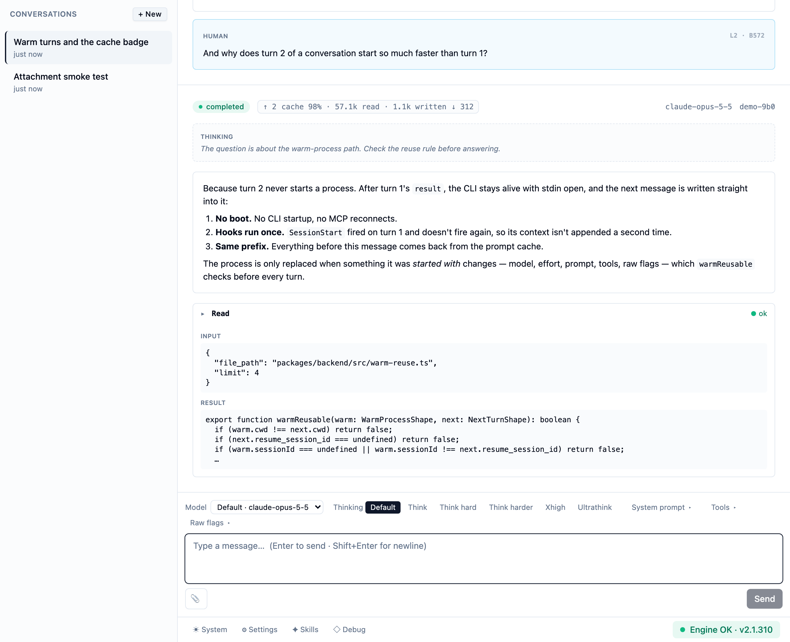
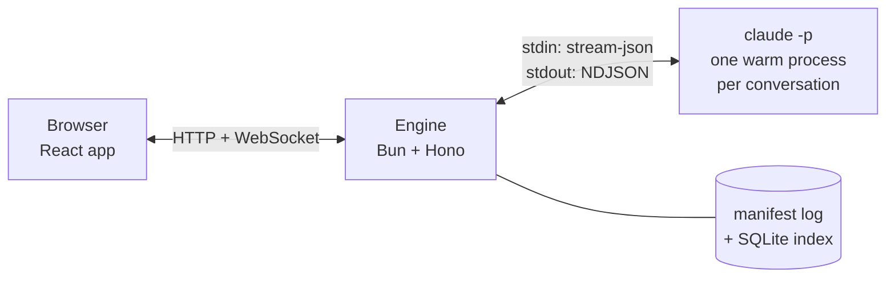

<h1 align="center">Clod UI</h1>

<p align="center">
  <b>A chat UI that lets you configure as much as possible about how the models show up,<br>runs every turn through the Claude Code CLI,<br>and shows you exactly what it ran.</b>
</p>

<p align="center">
  <a href="https://github.com/wolframs/clod-ui/actions/workflows/fast.yml"></a>
  
  
  <a href="./LICENSE"></a>
</p>

<picture>
  <source media="(prefers-color-scheme: dark)" srcset="./docs/assets/screenshot-dark.png">
  
</picture>

<p align="center"><sub>A scripted demo conversation, rendered by the real engine and web app.</sub></p>

No API client inside: a Bun engine runs `claude` headless
(`-p --input-format stream-json --output-format stream-json`), streams its
events over WebSocket, and a React app renders them. You can see and set the
things the CLI normally keeps out of sight: model, effort, tool allow and deny
lists, system prompt, raw flags, session resume, and the exact argv each turn
ran with.

> **Status, in the owner's words:** "Personal tool, under construction. Not
> intended for third-party use." Progress at a glance:
> [`docs/PROGRESS.md`](./docs/PROGRESS.md).

## How a turn runs



The first turn of a conversation spawns `claude`. Later turns are written into
the same process, so the CLI boots and its SessionStart hooks run once per
conversation, not once per turn. Change the model, effort, prompt, tools or
flags and the process is replaced, resuming the same session. History comes
from the CLI's own session transcripts, which the engine tails.

## What works today

- 🚀 **One command.** `bun run start` builds the web app if needed, boots the
  engine and opens a browser. A crashed engine is restarted once.
- 💬 **The conversation loop.** Sidebar, history, streaming turns with
  thinking and tool cards, markdown, cancel, auto-titles, reconnect-and-resume.
- 🎛️ **Visible controls.** The model picker lists what the CLI itself
  offers (name and resolved id, read from its `initialize` reply). Effort is
  the CLI's own scale, Auto · Low · Medium · High · XHigh · Max · Ultracode,
  with levels the chosen model doesn't take greyed out. Plus system prompt
  (append or override), tool allow/deny lists and raw argv, each mapped to
  a CLI flag.
- 🔍 **Debug panel.** Each turn's redacted argv and event timeline, whether
  it spawned or reused a process, and a "Copy repro" button.
- ♨️ **Warm processes.** One CLI per conversation between turns. The usage
  badge shows the prompt cache: share read, tokens read, tokens written.
  Retiring one stops its whole process group, bounded to ~2.5s.
- 📎 **Attachments.** Drag files into the composer; images go to the model
  as base64 blocks.
- ⚙️ **Panels for the rest.** Claude Code's `settings.json` behind a diff
  preview, a list of discoverable skills, light and dark themes, and a
  keyboard map (`n`, `/`, `j`/`k`, `?`, `Esc`).

**Not built yet:** `ci:nightly` (tape replay, real-CLI smoke) is a stub; chaos
and performance test tiers don't exist; the launcher only builds the web app
when it is missing.

## Prerequisites

- **Bun**, exactly the version pinned in [`.bun-version`](./.bun-version).
  `scripts/ci.ts` refuses to run on any other version.
  Install: `curl -fsSL https://bun.sh/install | bash`.
- **Claude Code CLI** on `PATH`, installed and authenticated. See
  [Anthropic's install docs](https://docs.claude.com/en/docs/claude-code/quickstart).
  Clod UI stores no credentials of its own; it inherits the CLI's.
- Developed on macOS. The fast gate also runs on Linux in GitHub Actions.
  Windows is untested.

## Run it

```sh
bun install
bun run ci:fast      # the whole gate: install, lint, typecheck, format, tests, README link-check
bun run start        # builds web (first run), starts the engine, opens a browser
```

## Environment

Read by the engine (the launcher passes its environment through). A template
with the remaining development variables is in [`.env.example`](./.env.example);
none of them are secrets.

| Variable                   | Effect                                                                                           |
| -------------------------- | ------------------------------------------------------------------------------------------------ |
| `CLOD_UI_ENGINE_PORT`      | Fixed port instead of an ephemeral one.                                                          |
| `CLOD_UI_NO_BROWSER`       | Launcher does not open a browser.                                                                |
| `CLOD_UI_APP_DATA_DIR`     | App data root (default `~/.local/share/clod-ui`).                                                |
| `CLOD_UI_CONVERSATION_CWD` | New conversations run in this directory (its CLAUDE.md, hooks, MCP config) instead of their own. |
| `CLOD_UI_CLAUDE_BINARY`    | Binary or wrapper script spawned for turns (default `claude` on PATH).                           |
| `CLOD_UI_WARM_IDLE_MS`     | How long a conversation's CLI process waits for its next turn (default 1h); `0` = one per turn.  |
| `CLOD_UI_WARM_MAX`         | Most CLI processes kept warm at once (default 4); the least recently used idle one goes first.   |
| `CLOD_UI_ALLOWED_ORIGINS`  | Extra origins (comma-separated) the same-origin guard accepts, e.g. a Vite dev server.           |
| `CLOD_UI_SWEEPER`          | Attachment sweeper: unset = off, `delete` = really unlink, anything else = dry run.              |

The engine binds `127.0.0.1` only. To reach it from other devices, put a
proxy in front that keeps the `Host` header (Tailscale Serve does). Writes and
WebSocket handshakes from another origin get a 403.

## Dev loops

```sh
bun run --filter '@clod-ui/engine' dev    # engine with hot reload
bun run --filter '@clod-ui/web' dev       # web UI (Vite dev server)
bun run test:fast                         # single `bun test` run
bun run web:test                          # the DOM tests, under Vitest
bun run ci:deep                           # ci:fast + Playwright against a real engine
bun run tape:record -- --name <slug> --prompt-file <path>   # capture a CLI tape fixture
```

`tape:record` spawns the real CLI and writes everything it said into
`tests/fixtures/cli-tapes/`, including the prompt. Read a tape before committing
it.

Git hooks (via [`lefthook.yml`](./lefthook.yml)): pre-commit runs
`lint:staged` + `typecheck`, pre-push runs `ci:fast`. `LEFTHOOK=0` bypasses.

## Under the hood

<details>
<summary><b>The event log</b></summary>

[`packages/manifest`](./packages/manifest) is an append-only NDJSON log, one
file per conversation at
`<app-data>/conversations/<conv-id>/manifest.json`. Each line is a
`ManifestEvent` carrying `seq`, `ts`, `hash_self` and `hash_prev` over a
canonical JSON encoding, so tampering with an earlier line is detectable.
Projected state is a pure fold over the log; nothing rewrites an earlier line.
A SQLite index (`engine.sqlite`) sits alongside it for list queries. The log is
authoritative; the index is derived.

Separately, [`packages/transcripts`](./packages/transcripts) tails Claude Code's
own JSONL session files under `<CLAUDE_HOME>/projects/<encoded-cwd>/` and
normalizes them into typed chat messages. That is the CLI's record, not ours.

</details>

<details>
<summary><b>Layout</b></summary>

```
apps/
  engine/      Bun + Hono server: health, conversations, turns, cancel, transcript,
               settings, skills, models, diagnostics, attachments, static
               SPA, /ws.
               SQLite index + append-only manifest + transcript watcher +
               auto-titling + same-origin guard.
  web/         Vite + React + Tailwind + shadcn/ui: sidebar, history, streaming
               turn view, composer with controls and attachments, panels.
  launcher/    One-command start: builds the web dist if missing, spawns the
               engine, polls /health, opens the browser, restarts a crashed
               engine once, forwards SIGINT/SIGTERM.

packages/
  contracts/   Zod schemas + typed client for engine ↔ web (single source of truth).
  backend/     `ClaudeBackend` interface. Real = `claude` subprocesses (warm per
               conversation); Tape = replay a recording; Scripted and Chaos live
               in test-kit.
  manifest/    The append-only event log (above).
  settings/    Atomic temp+rename writes with .bak rotation; unknown Claude
               Code settings keys survive a round-trip byte-for-byte.
  transcripts/ Watcher + normalizer for CC's own JSONL.
  test-kit/    TestEnv, FakeClock, ScriptedBackend, TapeBackend, ChaosBackend,
               MockEngineServer, typed test client, assertions, tape recorder.

tests/
  spine/       The spine contracts (T1.01–T1.20), catalogued in docs/SPINE.md.
  e2e/         Playwright deep tier.
  fixtures/cli-tapes/   Captured CLI tapes.
```

</details>

## Design docs

- [`plans/INDEX.md`](./plans/INDEX.md): index of every plan
- [`plans/2026-06-10-clod-ui-architecture-v3.md`](./plans/2026-06-10-clod-ui-architecture-v3.md): architecture (v3, with a v2 → v3 drift ledger)
- [`plans/2026-04-23-clod-ui-test-strategy-v1.md`](./plans/2026-04-23-clod-ui-test-strategy-v1.md): test layers L0–L8
- [`docs/INVARIANTS.md`](./docs/INVARIANTS.md): the nine contracts (I-1…I-9) that hardened across PRs
- [`docs/SPINE.md`](./docs/SPINE.md): what each spine test pins down
- [`plans/landed/`](./plans/landed/): one design doc per landed PR
- [`docs/archive/`](./docs/archive/): superseded v1 plans. History, not spec.

Plans are written before the code and describe intent at the time. Where a plan
and the code disagree, the code is what exists.

## Licence

MIT. The full text is in [`LICENSE`](./LICENSE).
